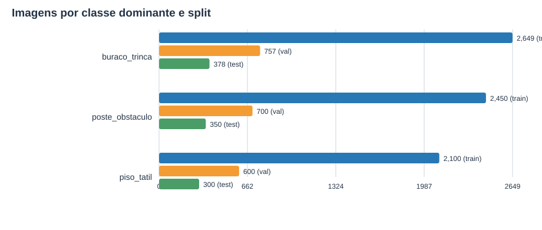

# Estatísticas do dataset CPZÃO

Gerado com seed 42; estratificação pela classe dominante. A divisão usa 70/20/10 por classe com arredondamento de maiores restos.

## Resumo

- Imagens válidas após balanceamento: **10,284**
- Bounding boxes válidos: **21,477**
- Split: train **7,199** (70.0%), val **2,057** (20.0%), test **1,028** (10.0%)
- Balanceamento: todas as imagens `buraco_trinca` mantidas; `poste_obstaculo` reduzida aleatoriamente a 3.500 (seed 42); `piso_tatil` aumentada a 3.000 (1.395 originais + 1.605 variações).
- Variações de piso tátil usam flip horizontal, rotação aleatória ±15°, brilho/contraste/saturação, motion blur leve e crop aleatório 0,85–1,0. Variantes da mesma origem permanecem no mesmo split para evitar vazamento entre treino, validação e teste.

## Imagens e bounding boxes por classe

| Classe | Imagens (classe dominante) | Bounding boxes |
|---|---:|---:|
| buraco_trinca | 3,784 | 9,122 |
| poste_obstaculo | 3,500 | 8,801 |
| piso_tatil | 3,000 | 3,554 |

## Distribuição por split

| Split | Total de imagens | buraco_trinca (imagens / caixas) | poste_obstaculo (imagens / caixas) | piso_tatil (imagens / caixas) |
|---|---:|---:|---:|---:|
| train | 7,199 | 2,649 / 6,403 | 2,450 / 6,158 | 2,100 / 2,483 |
| val | 2,057 | 757 / 1,775 | 700 / 1,697 | 600 / 725 |
| test | 1,028 | 378 / 944 | 350 / 946 | 300 / 346 |

## Origem por classe

| Dataset de origem | buraco_trinca (imagens / caixas) | poste_obstaculo (imagens / caixas) | piso_tatil (imagens / caixas) | Total de imagens válidas |
|---|---:|---:|---:|---:|
| BlindPath-Zebra_Dataset.v4i.yolov7pytorch | 0 / 0 | 0 / 0 | 3,000 / 3,554 | 3,000 |
| object on road.v1i.yolov7pytorch | 1,845 / 4,579 | 3,500 / 8,801 | 0 / 0 | 5,345 |
| road potholes and cracks.v1i.yolov7pytorch | 1,939 / 4,543 | 0 / 0 | 0 / 0 | 1,939 |
| **Total** | **3,784 / 9,122** | **3,500 / 8,801** | **3,000 / 3,554** | **10,284** |

## Classes descartadas

Anotações sem classe de destino foram filtradas individualmente; a imagem foi mantida se restou ao menos uma caixa válida.

No YAML original de `object on road`, o nome da classe de ID 0 é literalmente `0` (não há nome semântico). A inspeção visual de 12 exemplos mostra caixas sobre rampas/soleiras de acesso; não há evidência de que sejam postes, então o ID 0 ficou sem mapeamento. `dustbin` foi mapeada para `poste_obstaculo`.

| Dataset | Classe original | Anotações descartadas |
|---|---|---:|
| BlindPath-Zebra_Dataset.v4i.yolov7pytorch | Zebra Crossing | 274 |
| object on road.v1i.yolov7pytorch | 0 | 2,693 |
| object on road.v1i.yolov7pytorch | bus | 1,460 |
| object on road.v1i.yolov7pytorch | bus_stop | 704 |
| object on road.v1i.yolov7pytorch | car | 9,076 |
| object on road.v1i.yolov7pytorch | dog | 1,201 |
| object on road.v1i.yolov7pytorch | person | 7,670 |
| object on road.v1i.yolov7pytorch | ramp | 257 |
| object on road.v1i.yolov7pytorch | stop_sign | 2,070 |
| object on road.v1i.yolov7pytorch | tree | 5,007 |
| object on road.v1i.yolov7pytorch | truck | 969 |

## Alertas e recomendações

Todas as classes têm pelo menos 30 imagens com a classe como dominante.

## Imagens por classe dominante e split

## Sanidade

Todos os arquivos de imagem possuem label correspondente; os labels não estão vazios e os IDs pertencem a `{0, 1, 2}`.
