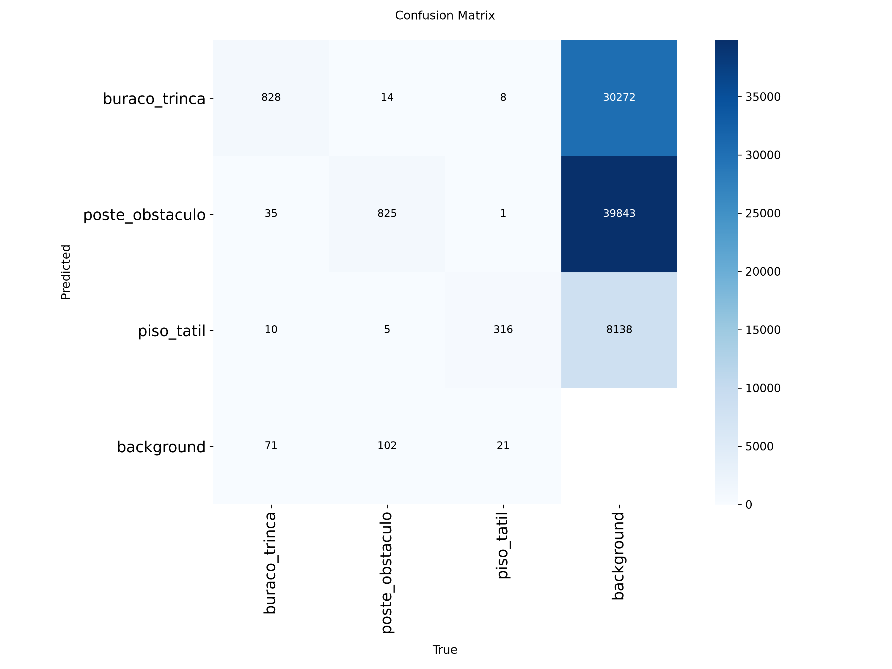

# Relatório de treino — CPZÃO YOLOv8n

Treino retomado em 12/10/2026 17:03:30 (horário de Brasília); tempo de treino contabilizado desde a execução inicial: **0.95 h** (56.8 min).
Hardware: **NVIDIA GeForce RTX 3060**; PyTorch 2.12.0+cu130; CUDA 13.0.
Treino retomado do checkpoint da época 6: limite total de 20 épocas, imgsz=640, batch=16, workers=0, AMP, patience=5, cache=False, seed=42. Avaliação abaixo usa exclusivamente `split=test`.

## Métricas no conjunto de teste

| Classe | Precision | Recall | mAP@50 | mAP@50-95 |
|---|---:|---:|---:|---:|
| buraco_trinca | 0.7464 | 0.6176 | 0.6893 | 0.3992 |
| poste_obstaculo | 0.7614 | 0.4621 | 0.5705 | 0.3638 |
| piso_tatil | 0.7894 | 0.7799 | 0.8128 | 0.5693 |
| **Média** | **0.7657** | **0.6199** | **0.6909** | **0.4441** |

## Matriz de confusão e análise crítica

A matriz abaixo foi gerada na avaliação do conjunto de teste.

A classe mais difícil é **poste_obstaculo** (recall 0.462, mAP@50 0.571), os menores valores entre as três classes. Na matriz visual, as omissões para background são o erro dominante (102 objetos poste_obstaculo não detectados); entre classes, há confusão principalmente entre buraco_trinca e poste_obstaculo (35 buracos previstos como obstáculos). Uma causa provável é a variedade visual reunida em poste_obstaculo (postes, bancos, guias e outros obstáculos), além de objetos pequenos ou parcialmente ocultos. Essa explicação é uma hipótese baseada na composição das classes e no padrão de erros, não uma causa comprovada por cada amostra.

## Artefatos

- `results.png`: curvas de treino/validação.
- `confusion_matrix.png`: matriz de confusão do teste.
- `PR_curve.png` e `F1_curve.png`: curvas do treino/validação.
- `test_metrics.json`: métricas numéricas completas e matriz, quando disponível.

## Fine-tuning continuado

O modelo inicial foi continuado por 24 épocas adicionais, com AdamW, imgsz=640, batch=8, workers=0, cache desativado e early stopping configurado para 8 épocas. O treino foi encerrado manualmente ao final da época 24. Hardware: NVIDIA GeForce RTX 3060. Tempo acumulado registrado pelo Ultralytics: 1h40min16s.

Avaliação do checkpoint de fine-tuning no mesmo split de teste:

| Classe | Precision | Recall | mAP@50 | mAP@50-95 |
|---|---:|---:|---:|---:|
| buraco_trinca | 0.8461 | 0.6049 | 0.7154 | 0.4241 |
| poste_obstaculo | 0.7869 | 0.4802 | 0.5896 | 0.3762 |
| piso_tatil | 0.8435 | 0.7786 | 0.8395 | 0.6054 |
| **Média** | **0.8255** | **0.6212** | **0.7148** | **0.4686** |

Comparado ao modelo inicial, a mAP@50 média aumentou 0.0240 e a mAP@50-95 aumentou 0.0245. `poste_obstaculo` continua sendo a classe mais difícil, embora seu recall tenha subido de 0.4621 para 0.4802.

- Checkpoint PyTorch: [`../../models/best_finetuned.pt`](../../models/best_finetuned.pt) (cópia do melhor peso do fine-tuning).
- Export ONNX instalado no app Android: `models/best_finetuned.onnx`.
- Resultado numérico detalhado: `finetune_test_metrics.json`.
